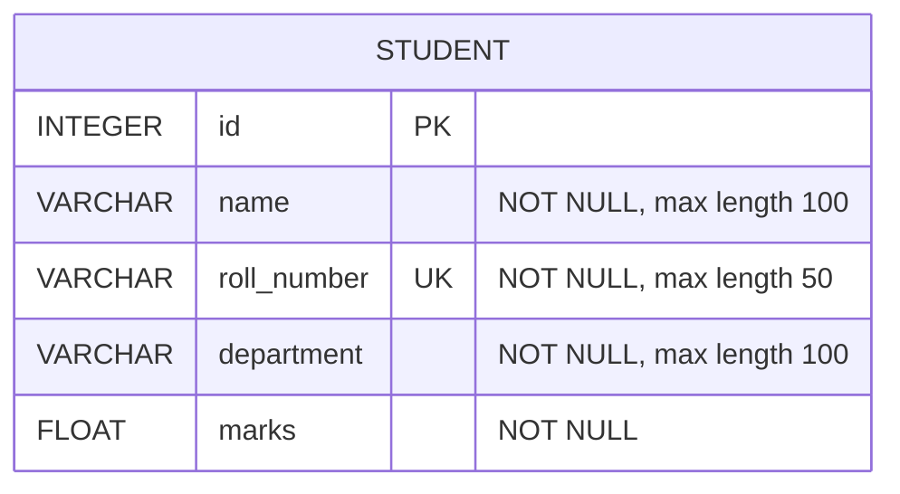

# Database Schema

## Entity Definition

The current application has one persistent entity: `Student`. It is declared as a SQLAlchemy model in `backend/app.py`. There are no implemented relationships or additional tables, so this design retains a single table.

| Column        | SQLite-oriented type | Nullability | Key/constraint                       | Description                                     |
| ------------- | -------------------- | ----------- | ------------------------------------ | ----------------------------------------------- |
| `id`          | `INTEGER`            | Not null    | Primary key; auto-assigned by SQLite | Internal student identifier returned by the API |
| `name`        | `VARCHAR(100)`       | Not null    | None                                 | Student name                                    |
| `roll_number` | `VARCHAR(50)`        | Not null    | Unique                               | Student's unique roll number                    |
| `department`  | `VARCHAR(100)`       | Not null    | None                                 | Department name stored with the student         |
| `marks`       | `FLOAT`              | Not null    | None                                 | Numeric marks value                             |

The SQLAlchemy model does not define a default or range constraint for `marks`. Its Python `float()` conversion is performed by the API on create/update, not enforced as a range constraint in SQLite. `VARCHAR` length declarations document the model's intended limits; SQLite does not enforce those lengths by itself.

## Relationships

No additional entity is required by the existing behavior. A student record contains a department string, but there is no department table or department-specific data in the application. The current schema therefore has no foreign keys or relationships.

If departments later require their own attributes or independent lifecycle, a separate `Department` table and foreign key could be considered. That is not part of the current design and would add unnecessary complexity now.

## Entity-Relationship Diagram



`PK` identifies the primary key; `UK` identifies the unique alternate key. The diagram has no relationships because the application has only one entity.

## SQLite DDL

This DDL represents the existing model's columns and constraints. `AUTOINCREMENT` makes the requested generated integer-key behavior explicit; SQLite's `INTEGER PRIMARY KEY` also assigns row IDs without that keyword, while `AUTOINCREMENT` additionally prevents reuse of previously issued row IDs.

```sql
CREATE TABLE student (
    id INTEGER PRIMARY KEY AUTOINCREMENT,
    name VARCHAR(100) NOT NULL,
    roll_number VARCHAR(50) NOT NULL UNIQUE,
    department VARCHAR(100) NOT NULL,
    marks FLOAT NOT NULL
);
```

The actual table name is determined by SQLAlchemy's default naming for the `Student` model (normally `student`). SQLAlchemy's SQLite type affinity means `FLOAT` is stored with numeric affinity; the application uses Python floats when constructing model values.

**Recommendation, not currently implemented:** after confirming the academic grading scale, add a database `CHECK` constraint and matching API validation. For a scale of 0 through 100, the optional column definition would be `marks FLOAT NOT NULL CHECK (marks >= 0 AND marks <= 100)`. Do not apply this until that scale is confirmed.

## Normalization Through Third Normal Form

- **First Normal Form (1NF):** Each column stores one value for a student; the model does not store repeating groups or lists in a column.
- **Second Normal Form (2NF):** The primary key is the single column `id`, so no non-key column depends on only part of a composite key.
- **Third Normal Form (3NF):** The model expresses no non-key-to-non-key dependency. The non-key student attributes describe the student identified by `id`; no department attributes or other facts are stored redundantly in this schema.

`roll_number` is also unique and acts as a candidate/alternate key, while `id` remains the API's stable primary identifier. If department facts are later added, separating them could avoid update anomalies, but the current single string attribute does not justify a new table.
