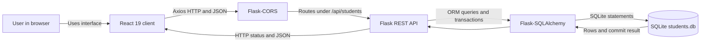

# System Architecture

## System Overview

Student Record Manager is a small client-server application. A browser-based React user interface sends JSON requests to a Flask REST API, which uses Flask-SQLAlchemy to read and write student records in a local SQLite database.

The architecture has four logical layers:

1. **Client:** React single-page application served by Vite during development.
2. **HTTP/API:** Axios sends requests to Flask routes under `/api/students`.
3. **Application/backend:** Flask defines the routes and request handling; the `Student` SQLAlchemy model in `backend/app.py` maps the student entity to a database table.
4. **Persistence:** SQLite stores records in `students.db` using the configured `sqlite:///students.db` URI. SQLAlchemy creates the table at application startup with `db.create_all()`.

The separate `backend/models.py` file is empty. The model currently lives in `backend/app.py`; it should not be treated as a separately implemented model layer.

## Technology Stack

| Layer         | Existing technology                                            |
| ------------- | -------------------------------------------------------------- |
| Frontend      | React 19, JavaScript, Vite, Axios                              |
| Backend       | Python 3, Flask, Flask-SQLAlchemy, Flask-CORS                  |
| API format    | REST-style HTTP routes with JSON request/response data         |
| Database      | SQLite, accessed through SQLAlchemy                            |
| Browser tests | Playwright, configured to start the frontend and Flask backend |

The Flask app enables CORS globally with `CORS(app)` so the development frontend on port `5173` can call the API on port `5000`. The frontend currently hard-codes `http://127.0.0.1:5000/api/students` in `frontend/src/App.jsx`.

## Architecture Diagram

## Component Responsibilities

- **React client:** Displays the student form and table, holds form/list state, submits create/update/delete operations, and fetches the list on initial render. The current UI exposes all five CRUD operations; single-record retrieval is available through the API but is not separately used by the UI.
- **Axios:** Sends requests to the configured API base URL and exposes response data and error bodies to the React component.
- **Flask/CORS:** Accepts cross-origin development requests and dispatches HTTP methods and URL paths to route functions.
- **Route handlers:** Parse JSON, perform basic required-field and duplicate-roll-number checks on create, query/update/delete records, serialize successful student results through `Student.to_dict()`, and commit changes.
- **Student SQLAlchemy model:** Maps `id`, `name`, `roll_number`, `department`, and `marks` to columns. It declares `id` as the primary key, required columns as non-null, and `roll_number` as unique.
- **SQLite:** Provides local persistent storage. No separate database server is required.
- **Vite/Playwright (development and test tooling):** Vite serves the frontend; Playwright starts or reuses the frontend and backend to run browser CRUD tests.

## Typical CRUD Request Flow

1. A user submits the React form or selects an action in the student table.
2. The client calls the Flask API with Axios. JSON writes use `POST` or `PUT`; deletion uses `DELETE`; the client refreshes the list with `GET` afterward.
3. Flask matches the method and URL to a handler. For writes, the handler obtains request JSON and reads or mutates a SQLAlchemy `Student` object.
4. SQLAlchemy translates model operations into SQLite statements. Writes are persisted when the handler calls `db.session.commit()`.
5. The handler returns a JSON value and HTTP status. Axios resolves or rejects the request, and React updates the displayed list or error message.

For a missing ID, `Student.query.get_or_404()` causes Flask to return a 404 response. The current default 404 body is not explicitly converted to the API's JSON error format.

## Scope and Deployment Notes

The observed configuration is appropriate for a local academic experiment. The development server runs on port `5000` with `debug=True`; this is not a production deployment configuration. Recommendations for production hardening and concurrency are in [DESIGN_REVIEW.md](DESIGN_REVIEW.md).
